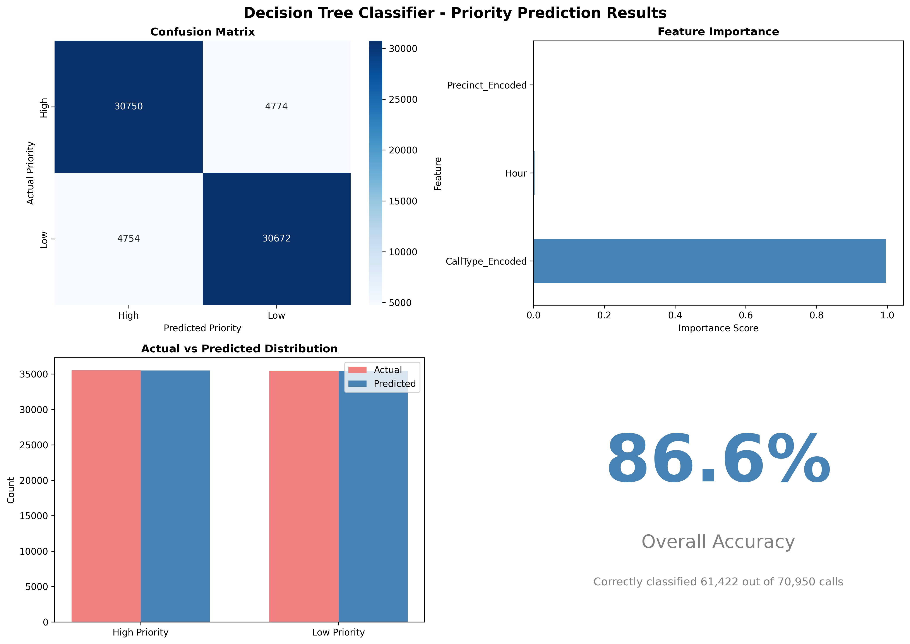

# Seattle 911 CAD — Priority Classification

Seattle's police department answers millions of 911 calls. This project asks whether historical dispatch data can predict a call's priority — and, separately, its response time — using 5.2 million Seattle 911 call records.

From Northeastern's ALY6110 Big Data and Data Management course (instructor Daya Rudhramoorthi, CRN 80199, Spring 2026). Group 12: Qiu Chenhao and Dev Panchal.

## In plain language

When someone calls 911 in Seattle, the dispatcher assigns a priority: 1 is the most urgent, 5 the least. This project asks two questions:

1. **Can we predict how long the police will take to respond?** (Random Forest regression, by partner Qiu Chenhao.)
2. **Can we predict the priority from the call's type, place and time?** (Decision Tree classification, by Dev.)

The answer to the second question is yes — 86.57% accuracy — but with a catch this README states plainly: the call type almost entirely determines the priority, so the model largely restates the dispatch mapping. It is a useful check on how dispatch works, not a discovery that call type matters (dispatchers already know that).

## The data

- **Source:** Seattle Police Department 911 Call Data, City of Seattle Open Data Portal — "Call Data" (33kz-ixgy), https://data.seattle.gov/Public-Safety/Call-Data/33kz-ixgy/about_data.
- **Size as the project states it: 5.2 million rows, 17 columns, calls from 2001 to the present.** About 5–8% missing values (~4% missing location, ~7% incomplete resolution); about 5% of calls are withheld from the public data.
- **The model itself ran on a 354,781-record local extract** (the notebook reads `Seattle_911_CallData.csv` with `nrows=500000` and actually loaded 354,781 records; 354,750 after cleaning).
- **Dataset exception, stated honestly:** the dataset file is **not in this repo** — it is not on the Mac either (a 5.5 GB file, per the notebook's comment). The README cites the portal link above instead. Do not claim the dataset is included.

Two disagreements in the project files, flagged not smoothed: the final PDF says "over 10 million records spanning 2009–2026" where the data-selection document and the final report say 5.2 million rows from 2001; and the PDF's Decision Tree metrics page says 85.24% accuracy where the notebook, the final report and the same PDF's conclusions page all say 86.57%. The README quotes the notebook-verified figures (5.2M, 86.57%) and notes the PDF's stale pages.

## What the dashboards show (Week 4)

Two dashboards, five graphs each:

- **Call types:** disturbance calls ~18%, suspicious person ~16% — together about a third of all calls.
- **Outcomes:** report writing without arrest ~59%, physical arrests ~18%, unable to locate ~11%.
- **Where and when:** the West precinct (downtown) has the highest volume. Calls peak on Fridays and at midday, and are lowest between 3–6 AM. Volume peaked around 2020 at 400,000+ calls a year, then declined to around 200,000 a year.

## Model 1 — Random Forest: predicting response time (partner's model)

Target: response time in minutes. Features: initial call type, final call type, priority, time variables, clearance description. 80/20 split.

- **MAE ~6–7 minutes, RMSE ~10.60, R² ~0.29.**
- **Priority is the dominant predictor — about 3× more important than any other factor.**

Note: this model is described in the final report and the PDF only — **no code or notebook for it exists on the Mac**, so its numbers come from the report text, not from a verified code run. The README says so.

## Model 2 — Decision Tree: predicting priority (Dev's model)

Binary target: Priority 1–2 = High (177,618 calls), Priority 3–5 = Low (177,132 calls). Features: Initial Call Type, Dispatch Precinct, Hour. Train 283,800 / test 70,950 (80/20, stratified, random state 42).

- **Accuracy 86.57%; precision, recall and F1 all 0.87 for both classes.**
- Confusion matrix: [[30750, 4774], [4754, 30672]].
- **Feature importance: Call Type 0.9959 (99.59%), Hour 0.0030, Precinct 0.0011 — Call Type is 336× more important than Hour.**

**The honest limitation, stated in the final report itself:** call type almost entirely determines priority — WEAPON and ASSAULT calls are almost always high priority, PARKING and NOISE almost always low. The model largely restates the dispatch mapping, and because it learns from human-assigned priorities, it can repeat past biases in those assignments. Its value is in quantifying that mapping and in giving dispatch a fast, checkable triage signal — not in discovering that call type matters.

## What is in this repo

- `week-3-data-selection/` — the data-selection report (dataset description, 5.2M rows, portal link).
- `week-4-dashboards/` — the Module 4 dashboard report (3 May 2026).
- `week-6-final-project/` — Dev's Model 2 notebook (`Group12_Model2_Dev_Panchal.ipynb`), the final project report (docx), the analysis PDF, and the presentation (pptx).
- `images/` — the priority-prediction results chart from Week 6.

## How to use it

1. Read `week-6-final-project/Week 6 Final Project.docx` for the full write-up, including both models and their limitations.
2. Run `week-6-final-project/Group12_Model2_Dev_Panchal.ipynb` with a local extract of the Seattle Call Data from the portal link above (the 5.5 GB full file is not included).
3. Start with `week-3-data-selection/` for the dataset description and `week-4-dashboards/` for the descriptive picture before the modelling.

## Tools

Python, pandas, scikit-learn (Decision Tree, Random Forest), Power BI (Week 4 dashboards), Seattle Open Data Portal.

## What was left out, and why

- **Week 1 FEMA essay** (hurricane response case study) — a different topic, not Seattle CAD.
- **Week 2 bicycle-accidents EDA** (827,861 UK bicycle accidents, 1979–2018) — a different dataset and a different project; its data files (72 MB and 108 MB) are also over the Mac transfer cap.
- **Week 3 IMDB research paper** (in-memory databases) and **Week 3 PySpark lab** (population and housing sales) — different topics, not Seattle CAD.
- **Week 4 `.pbix` dashboard file** (57 MB) — over the Mac transfer cap; the dashboards are already covered by the staged Module 4 report.
- **Professor lecture presentations** — course material, not project work.
- The Week 3 copy of the analysis PDF — byte-identical text to the staged Week 6 copy; staged once.

## Conclusion

Seattle's 911 data tells a clear operational story: a third of calls are disturbances and suspicious persons, downtown takes the most volume, and priority is driven almost entirely by what the call is about. The Decision Tree proves that quantitatively — 86.57% accuracy with call type doing 99.59% of the work — and the project's own honesty about that result is its strength: a model that restates how dispatch already works is a check on the system, not a replacement for the people making the calls.
